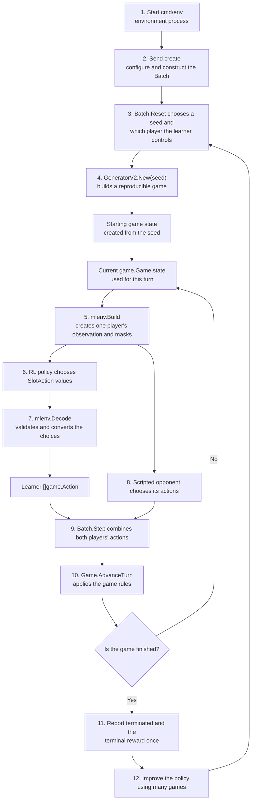
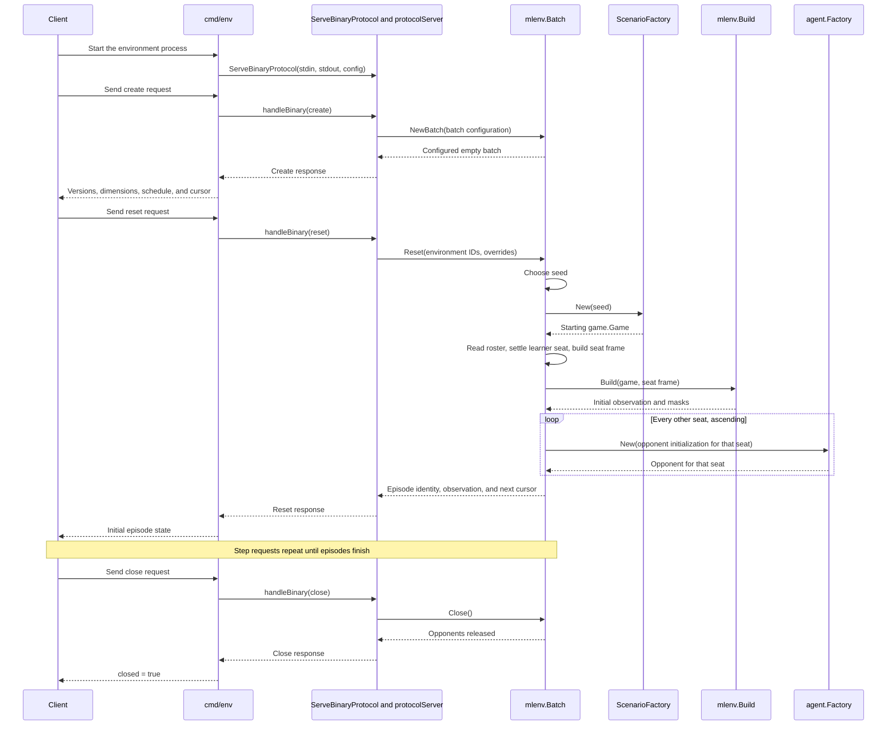
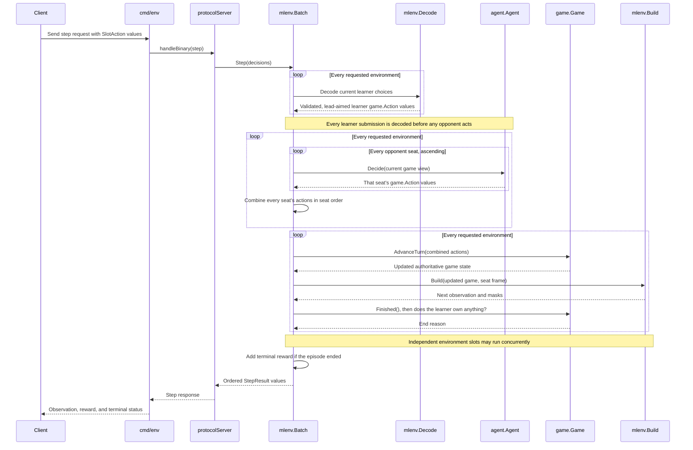

# Understanding the RL environment

Start with [the game in brief](../README.md#the-game-in-brief) if the game
rules themselves are not yet clear. This guide explains a different question: how those rules and the
current game state are presented to a reinforcement-learning (RL) agent.

The sections follow the same order as the environment itself: start and
configure the environment, schedule and generate an episode, describe the
resulting game as an observation, constrain the available choices with masks,
decode one choice into engine actions, advance the game, and report its result.

## The short version

An RL agent, called the learner, plays one seat of a two- or four-player game.
Before each turn, the environment shows it a numeric summary of the board. The
learner chooses what to do, the environment turns that choice into ordinary
`game.Action` values, and the Go engine runs the turn. Training repeats this
process over many games and uses the results to improve the learner's future
choices.

The RL code does not replace or modify the game rules. `game.Game` and
`AdvanceTurn` remain the authority on launches, movement, combat, production,
and winning.

## Batch, slot, game, and episode

These words describe different levels of the environment and are not
interchangeable:

- A **batch** is the top-level container used to run several games together.
- An **environment slot** is one stable numbered position in that batch, such
  as slot 0 or slot 1.
- A **game** is the mutable `game.Game` containing the planets, fleets, ships,
  turn number, and rules configuration.
- An **episode** is one learner experience from `reset` until that game ends.
  It includes the game, which player the learner controls, the opponents in
  every other seat, the observations, the submitted actions, and the final
  reward.

The hierarchy for a batch with three environment slots looks like this:

```text
Environment session
└── Batch
    ├── Environment slot 0
    │   └── Active episode
    │       ├── EpisodeInfo: environment ID, seed, learner player
    │       ├── game.Game: authoritative mutable state
    │       ├── Learner seat frame, fixed at reset
    │       ├── Scripted opponent for every other seat
    │       └── Current learner observation
    ├── Environment slot 1
    │   └── Active episode
    └── Environment slot 2
        └── Active episode
```

A batch contains multiple environment slots. Each slot holds one active
episode at a time and can run many episodes sequentially through repeated
resets:

```text
Environment slot 0
├── reset → episode A → game ends
├── reset → episode B → game ends
└── reset → episode C → game ends
```

The slot ID remains stable, but `reset` replaces the episode in that slot with
a newly generated game and new opponents. Internally, the private
`environment` struct stores that active episode state.

`EpisodeOverride` and `EpisodeInfo` describe opposite sides of reset:

| Type | Used as | Meaning |
|---|---|---|
| `EpisodeOverride` | Optional reset input | Tells `Batch.Reset` to use a specific seed and learner player for one slot instead of taking the next scheduled assignment. It is used for replay and debugging and does not advance the schedule cursor. |
| `EpisodeInfo` | Reset result and later step identity | Records the slot ID, seed, learner player, and whether the assignment was explicit. It travels with observations and results so they can be attributed and replayed correctly. |

For example, this override asks slot 3 to replay seed 42 from player 1's point
of view:

```go
EpisodeOverride{EnvID: 3, Seed: 42, Seat: 1}
```

The resulting identity is:

```go
EpisodeInfo{EnvID: 3, Seed: 42, Seat: 1, Explicit: true}
```

Without an override, the schedule chooses the seed and learner player and the
result has `Explicit: false`. The same seed can produce a different learner
episode for each seat — two on a two-player map, four on a four-player one —
even though the generated starting board is the same.

## The complete reinforcement-learning workflow



### What each step does

1. **Start the environment process.** The client starts `cmd/env`, which stays
   alive while the client runs multiple games.
2. **Create the batch.** The client sends `create` with the batch size, seed
   range, schedule, starting cursor, and scripted opponent. A direct Go caller
   performs the equivalent setup by constructing a `Batch`.
3. **Reset an environment.** `Batch.Reset` chooses the scenario seed and which
   seat the learner controls, then starts an episode in that
   batch slot.
4. **Generate the starting game.** `GeneratorV2.New(seed)` deterministically
   creates the starting planets, owners, ships, players, and engine
   configuration. This `game.Game` is the current state for the first turn.
5. **Observe the current state.** `mlenv.Build` describes the game from the
   learner's point of view and identifies the choices currently allowed. It
   does not play or change the game.
6. **Choose the learner's move.** The RL policy reads the observation
   and produces `SlotAction` choices.
7. **Decode the learner's choices.** `mlenv.Decode` validates the selected
   source and target slots and converts them into ordinary `game.Action`
   values.
8. **Choose the opponent's move.** The configured scripted opponent examines
   the same game from its own point of view and produces its actions.
9. **Combine the actions.** `Batch.Step` collects both players' actions so the
   engine can apply them as simultaneous choices.
10. **Play one turn.** `Game.AdvanceTurn` applies launches, production,
    movement, collisions, combat, and the other authoritative game rules. If
    the game continues, its updated state loops back to step 5.
11. **Report the result.** When the game finishes, the environment reports
    `terminated` and emits the learner's terminal win, loss, or draw reward
    once.
12. **Improve the policy.** The PPO training code uses results from many
    games to update the policy, then resets environments to begin more
    episodes.

Steps 1 and 2 happen once for an environment session. Steps 5 through 10 make
up one game turn and repeat until the game finishes. A new scenario is
generated only when step 3 starts another episode.

### How requests move through the code

The workflow diagram above describes what happens. The following sequence
diagrams show which parts of the code call each other. The outer request path
is in [protocol.go](protocol.go), the batch lifecycle is in [env.go](env.go),
learner choices are translated in [action.go](action.go), and the authoritative
turn runs in [`game/game.go`](../game/game.go).

#### Creating the batch and starting an episode



`NewBatch` validates and stores the session configuration, but it does not
create a game. `Batch.Reset` is the operation that consumes a scheduled
episode, creates its game and opponents, and builds its first observation.

#### Playing one turn



Decoding and opponent decisions prepare the turn without changing the game.
The call to `Game.AdvanceTurn` changes the authoritative state. `Build` then
reads that updated state to prepare the observation for the following turn.

The generator, game engine, observation builder, masks, action decoder, batched
environment loop, and Go environment process are implemented now. The loop
obtains every opponent's actions and submits all players' choices to
`AdvanceTurn` together, preserving the engine's simultaneous-action rule. The
Python client, a legal random controller, and PPO training of the learned
policy (`python/orrery/train.py`) use this environment.

## What is implemented now

The repository implements the whole loop:

1. The [`scenario`](../scenario/) package creates reproducible two- and
   four-player training boards (generator-v2 and generator-v2-4p) from explicit
   seeds, with orbiting planets, comets, and the sun.
2. [seat_frame.go](seat_frame.go) fixes how each learner seat sees the board,
   and [observation.go](observation.go) with the `observation_*.go` files turns
   a `game.Game` into the fixed-size obs-v2 description from that seat (see
   [The observation (obs-v2)](#the-observation-obs-v2)).
3. [incoming.go](incoming.go) predicts where fleets already in flight are
   heading and how soon they will arrive.
4. The observation includes masks that identify real bodies, owned bodies,
   seated players, and available source-to-target choices.
5. [action.go](action.go) validates those choices and turns them into ordinary
   `game.Action` values that the rules engine accepts, aiming with lead.
6. [env.go](env.go) runs independent two- or four-player games as a batch,
   schedules their seeds and learner seats, obtains every opponent seat's
   actions, and reports terminal rewards.
7. [protocol.go](protocol.go) and [protocol_codec.go](protocol_codec.go)
   transport that API as env-v3 binary frames, while [`cmd/env`](../cmd/env/)
   provides the stdin/stdout process.
8. [`python/scripts/smoke.py`](../python/scripts/smoke.py) drives the reusable
   Python client through eight complete episodes to verify that process.
9. [`python/orrery/env_client.py`](../python/orrery/env_client.py) owns that
   process, validates protocol responses, and converts observations to
   fixed-shape NumPy arrays.
10. [`python/orrery/random_agent.py`](../python/orrery/random_agent.py)
    samples only choices allowed by the observation masks, providing the first
    end-to-end Python controller.
11. [`python/orrery/train.py`](../python/orrery/train.py) trains the
    learned policy with PPO through the same client.

## Scenario package and generated maps

The [`scenario`](../scenario/) package sits between the arena or the ML
environment and the authoritative [`game`](../game/) engine. It turns a scenario
seed into a fair, reproducible starting game; it does not implement or
duplicate game rules.

The arena defines the boundary that generated and fixed scenarios implement:

```go
type ScenarioFactory interface {
	ID() string
	New(seed int64) (*game.Game, error)
}
```

There are currently two factories:

- `fixed-v1` always uses the same explicit six-planet layout. Its seed still
  controls any rule-driven engine randomness.
- `generator-v1` builds a new symmetric layout from each seed for the static
  two-player ML variant.

A replay is therefore identified by the scenario factory ID, scenario seed,
and accepted action batches. A seed alone is insufficient because different
factory versions can interpret the same seed differently. Persisted action
records contain the scenario ID and seed, and replay rejects a factory whose
ID does not match the record.

### Generator flow

`scenario.GeneratorV1{}.New(seed)` derives two independent random streams from
the supplied seed:

```text
scenario seed
    |
    +-- FNV-1a(seed, "orrery-generator-v1-map")
    |       `-- private map RNG
    |              `-- generate planets
    |
    `-- FNV-1a(seed, "orrery-generator-v1-engine")
            `-- private engine RNG

generated planets + static two-player configuration
    `-- game.New(...)
            `-- authoritative engine validation and initialization
```

Map generation and engine gameplay use separate seed-derived random-number
generators. Consequently, changing how many random values the map generator
uses does not alter the engine's random values, and engine changes do not alter
the generated map. This lets the two systems evolve independently without
breaking recorded scenarios. Each call also creates fresh RNG objects, so
concurrent arena workers never share mutable random state. The domain names and
seed-derivation formula are part of the `generator-v1` replay contract.

The generator ID and seed form the stable map key. Changing any choice that
maps a recorded seed to a different board requires a new generator version;
golden-map tests guard that contract.

### Generated-map contract

One `generator-v1` map contains:

- Two home planets and three to five neutral pairs, for 8, 10, or 12 planets
  in total.
- Two-fold rotational symmetry around the sun. Every pair is separated by a
  180-degree rotation through the sun's position.
- Player 0's and player 1's home planets as the first pair, each with 10 ships
  and production 5.
- Neutral pairs with a shared production sampled from 1 through 5 and a
  garrison of `10 * production` ships.
- Sequential planet IDs: `1, 2` are the homes, `3, 4` are the first neutral
  pair, and so on.
- Static planets, no comets, and no sun hazard, matching the two-player RL
  environment variant.

Both members of a pair have the same production and garrison as well as
mirrored positions. This makes each side economically and geometrically equal,
so an agent cannot obtain a systematic advantage merely from its seat.

Planet radius is derived from production through the engine's public
`game.PlanetRadius` formula. The generator uses that formula while checking
placement, and `game.New` remains authoritative by validating the proposed
state and deriving the final radii.

### Deterministic placement

For each pair, the generator:

1. Samples a candidate position from its private map RNG.
2. Reflects it through the sun to obtain the second position:
   `mirror = 2 * sunPosition - candidate`.
3. Checks that both complete planet discs are inside the board.
4. Checks both planets against the sun and every previously placed planet.
5. Checks the mirrored planets against each other.
6. Accepts the pair or deterministically samples the next candidate.

Every planet must have at least 2 units of empty space between its surface and
the sun or another planet. If a position is invalid, the generator tries the
next position in the seed's repeatable sequence. The same seed therefore makes
the same attempts and produces the same map. After 1,000 failed attempts, it
returns an error instead of retrying forever.

### Seed budgets

[`scenario/seeds.go`](../scenario/seeds.go) handles experiment bookkeeping; it
does not influence how a particular map is generated. A `SeedRange` is a
half-open interval `[Start, End)`, so `[0, 100)` contains seeds 0 through 99
and can touch `[100, 200)` without overlap.

The currently implemented standard budget is:

| Purpose | Range | Number of seeds | Intended use |
| --- | ---: | ---: | --- |
| Training | `[0, 1000000)` | 1,000,000 | Sampled freely and repeatedly during training. |
| Validation | `[1000000, 1010000)` | 10,000 | Used repeatedly for model selection and release-readiness checks. |
| `eval-1` | `[1010000, 1011000)` | 1,000 | First protected final-evaluation attempt. |
| `eval-2` | `[1011000, 1012000)` | 1,000 | Second protected final-evaluation attempt. |
| `eval-3` | `[1012000, 1013000)` | 1,000 | Third protected final-evaluation attempt. |
| `eval-4` | `[1013000, 1014000)` | 1,000 | Fourth protected final-evaluation attempt. |
| `eval-5` | `[1014000, 1015000)` | 1,000 | Fifth protected final-evaluation attempt. |

`Ranges.Validate` rejects missing, unnamed, duplicate, empty, or inverted
evaluation pools and checks every pair of all seven ranges for overlap.
`StandardRanges()` returns a deep copy of the budget, including a new
evaluation-pool slice, so a caller cannot mutate shared global range state.

Protected pools are spent in order. A frozen checkpoint uses `eval-1`; if that
evaluation fails and a later checkpoint qualifies, it uses `eval-2` rather
than tuning against and reusing `eval-1`. The pool name and exact half-open
bounds belong in the evaluation result's replay metadata.

The arena does not enforce these ranges. Its `-seed` flag selects the first
seed and scenario `i` receives `seed + i`, so the caller must keep the requested
scenario count inside the intended budget.

### Arena usage and seat swapping

Select the generated scenario from the arena CLI with:

```bash
go run ./cmd/arena \
  -scenario generator-v1 \
  -seed 1000000 \
  -scenarios 100
```

The arena schedules consecutive scenario seeds. Each seed is played twice on
the identical generated board: once with the original seat assignment and once
with the two contestants swapped. Results stay in deterministic schedule order
regardless of worker completion order. Thus `-scenarios 100` means 100 maps and
200 games.

`generator-v1` is connected to both the arena CLI and `mlenv.Batch`. A batch
reset asks the same factory to construct an independent game for the assigned
seed, so arena matches and ML episodes share one seed-to-game boundary.

### Generator verification

The tests in [`scenario/generator_test.go`](../scenario/generator_test.go) verify:

- Repeated resets with the same seed produce identical maps.
- Golden hashes freeze representative `(generator ID, seed) -> map` results.
- Map and engine RNG streams are stable and distinct.
- A 10,000-seed sweep produces legal, symmetric, correctly spaced maps.
- The first 1,000 seeds produce distinct maps rather than one degenerate fixed
  layout.
- Generated games remain static, comet-free, and sun-hazard-free.
- Planet IDs remain sequential and impossible placement fails rather than
  looping forever.

The tests in [`scenario/seeds_test.go`](../scenario/seeds_test.go) cover overlap,
touching boundaries, empty and inverted intervals, overflow-safe lengths,
exact standard pool names and bounds, all-seven-range disjointness, and the
deep-copy semantics of `StandardRanges()`.

## Useful terms

| Term | Plain-language meaning |
|---|---|
| **Environment** | The layer connecting the learner to the Go game engine. It prepares observations and translates slot decisions into engine actions. |
| **Batch** | A container that runs a fixed number of independent environment slots. |
| **Environment slot** | One stable numbered position in a batch. Reset replaces the episode in that position. |
| **Episode** | One learner experience from reset through repeated turns to a terminal result. |
| **Game** | The authoritative mutable `game.Game` simulated during an episode. |
| **Learner seat** | The player number, 0 to 3, controlled by the learner for an episode. |
| **Observation** | Everything the agent is shown about the current game state before choosing a move. |
| **Feature** | One fact stored in an observation, such as position, ships, ownership, or incoming fleets. |
| **Body slot** | One observation row reserved for a planet or comet. |
| **Padding** | Empty rows that keep every observation the same size when a board has fewer bodies. |
| **Mask** | A true/false marker explaining which rows or choices are real and available. |
| **Normalization** | Converting values with different scales into small numeric ranges that are easier for a model to process. |
| **Sentinel** | A reserved value with a special meaning. For arrival time, `1.0` means that no fleet is predicted to arrive. |

## One example

Imagine the engine currently contains this state:

```text
You are player 0.

Planet 1
- owner: player 0
- position: (20, 50)
- ships: 40
- production: 3 ships per turn

Planet 2
- owner: player 1
- position: (80, 50)
- ships: 25
- production: 2 ships per turn

Fleet 9
- owner: player 1
- ships: 10
- travelling toward Planet 1
- predicted to arrive in 2.4 turns
```

`mlenv.Build(game, frame)` creates player 0's observation, where `frame` is
player 0's seat frame (see
[Seeing every seat from the same chair](#seeing-every-seat-from-the-same-chair)).
In plain language, the row for Planet 1 tells the agent:

```text
This is a real planet.
It belongs to me.
It has 40 stationed ships and produces 3 per turn.
A force of 10 ships from the opposite seat is heading here.
That seat's first fleet will arrive in 2.4 turns.
I may launch from this planet because I own it and it has ships.
```

The real observation stores scaled numbers rather than these sentences, but
the meaning is the same. `Build` does not move Fleet 9 or change Planet 1. It
creates a separate `Observation` value describing what is already in the
game.

Building the same state for player 1 changes only the point of view. Planet 1
becomes owned by player 1's opposite seat, and Fleet 9 becomes its own
incoming fleet. Ships, production, and predicted arrival time remain
unchanged; positions are rotated so player 1's home sits where player 0's did.

## How incoming fleets are predicted

The engine stores a fleet's current position and how far it moves each turn.
`predictFleets` in [incoming.go](incoming.go) asks `Game.PredictFleets` to play
the turns forward on a private copy of the board, without moving the real
fleets or changing the game. For each future turn it:

1. Moves every orbiting planet and comet one step, recording each body's path,
   exactly as the engine does.
2. Tests each fleet's next one-turn movement segment against those paths, so a
   fleet and a moving body are compared at the same instant.
3. Removes comets that reached the end of their path. A fleet that hit one of
   them that same turn is lost with it, as in a real turn.
4. Keeps any fleet that hit nothing flying from the segment's endpoint.

Each fleet stops when it reaches a planet, reaches a comet, leaves the board,
or crosses the enabled sun.

A segment is one future turn of travel. Segments are numbered from zero, and
the prediction reports `T`, the fraction of the hit segment completed before
the collision. The predicted arrival time is therefore:

```text
zero-based segment number + fraction of that segment
```

For example, a hit 40% of the way through segment 2 arrives in `2 + 0.4 = 2.4`
turns.

A fleet launched on the current turn ignores its source planet during segment
0, exactly as the engine does when that fleet first leaves. The exclusion is
removed before predicting later segments.

Future comet waves are not predicted. A wave's paths come from the game's
random numbers, which agents cannot know in advance either. A fleet still flying
after the next wave turn (50, 150, 250, 350, or 450) could be caught by a comet
the prediction never saw.

The walk is bounded by the maximum number of one-turn segments needed for the
slowest legal fleet to cross the board diagonal. This safety bound comes from
the board geometry, not from how arrival times are scaled for the observation:
a display scale must not decide whether the prediction is allowed to finish.

A planet or comet hit becomes an incoming fleet for that body. A board-edge
or sun hit destroys the fleet, so it is not listed as incoming anywhere.

If several fleets are heading toward the same body, their ships are added up
separately for each role (me, clockwise, opposite, counter-clockwise), and the
body records each role's earliest arrival time. Roles are always relative to
the player receiving the observation.

The predictor asks the engine's public `Game.FirstHit` method instead of
copying its collision mathematics. [parity_test.go](parity_test.go) also
advances real games and checks that predicted destinations and arrival turns
match what the engine does.

## What the masks answer

Masks prevent padding and unavailable choices from looking like valid game
options:

| Mask | Question it answers |
|---|---|
| `BodyMask` | Does this slot contain a real planet or comet? |
| `OwnedMask` | Do I own the body in this slot? |
| `PlayerMask` | Does this slot describe a seated player? |
| `TargetMask` | Can this source choose this target? |

For example, a padding slot is not a real target. A planet cannot target
itself. A planet owned by the opponent cannot be one of your launch sources.
A friendly planet can still be a target because sending reinforcement is a
legal move.

These masks describe available choices; they do not execute a choice. The
action decoder checks a decision against them before creating engine actions.

## The observation (obs-v2)

The observation describes the full game: two or four players, orbiting
planets, comets, and the sun hazard. Its schema is named `obs-v2`; the name
keeps its version because checkpoints record it. `Build(game, frame)` in
[observation.go](observation.go) produces it.

A model needs the same input shape on every turn, so the observation always
reserves the same number of rows; boards with fewer bodies leave the extra
rows as zero-filled padding, and the masks below say which rows are real.
Board values are scaled so one large number does not overwhelm the smaller
ones; the scales are fixed by the schema (see [Normalization](#normalization)).

### Seeing every seat from the same chair

A policy plays better when every seat looks alike. obs-v2 therefore turns the
board so the observer's starting home always sits where player 0's home
started, and it names opponents by where they sit rather than by player ID:

- **me**
- **clockwise**: the next seat clockwise around the sun
- **opposite**: across the sun
- **counter-clockwise**: the next seat the other way

A **seat frame** ([seat_frame.go](seat_frame.go)) records this once per
episode and seat. `NewSeatFrame(game, observer)` must be called at turn 0. It
checks the board first: square, sun at the centre, one home per seated player,
and every home exactly a quarter-turn rotation of player 0's. Then it fixes:

| Observer (4 players) | Quarter-turns | Players as me, cw, opposite, ccw |
|---|---:|---|
| 0 | 0 | 0, 1, 3, 2 |
| 1 | 3 | 1, 3, 2, 0 |
| 2 | 1 | 2, 0, 1, 3 |
| 3 | 2 | 3, 2, 0, 1 |

With two players, player 1 is always "opposite" and sees the board turned
twice. Going clockwise, seats run 0 → 1 → 3 → 2, because that is the order in
which the generator lays out each group of four planets.

The frame never changes during the episode. If an opponent captures my home,
it is still "clockwise" to me, because roles describe where players started.
Orbits do not break the frame either: every planet orbits at the same rate, so
the four homes turn together and stay exactly a quarter-turn apart. A frame
also belongs to one game object. `Build` refuses a frame made for any other
game, even an identical copy.

Turning uses only swaps and sign changes of coordinates, so it adds no
rounding error. Directions, such as a comet's next step, are turned the same
way but are not moved about the sun.

### Slots

There are 44 body slots and 4 player slots:

| Slots | Holds |
|---|---|
| 0–39 | Planets, in ascending ID order |
| 40–43 | Active comets, in ascending ID order |

At most one comet wave of four is on the board at a time, so four comet slots
are enough. With 20 planets and two comets, slots 0–19 and 40–41 are real and
the rest are padding. A board with more than 40 planets, more than four
comets, a malformed comet path, or an owner outside the starting roster is
refused rather than encoded wrongly.

### Body columns

Each real body has 27 columns. The `Feature...` constants in
[observation.go](observation.go) name them.

| Columns | What they hold |
|---|---|
| 0–1 | Position after turning, from −1 to 1 about the board centre |
| 2–4 | Radius, production, and ships |
| 5–9 | Owner: me, clockwise, opposite, counter-clockwise, or neutral (exactly one is 1) |
| 10–11 | Whether the planet orbits, and its signed orbit rate |
| 12–15 | Whether it is a comet, its turns left, and its step to the next path point |
| 16–19 | Ships heading here from each role |
| 20–23 | Earliest arrival from each role (1 means none) |
| 24–26 | Turn progress, turns until the next comet wave, and sun radius |

A few columns are worth explaining:

- **Comet step (14–15).** One position cannot tell a comet coming towards you
  from one moving away, and the model has no memory of earlier turns, so each
  comet carries its next step. It is 0 on a comet's last point.
- **Incoming per role (16–23).** Arriving fleets of different owners fight
  each other before touching the garrison. Ten ships each from two opponents
  cancel out, while twenty from one opponent hit in full. One combined "enemy"
  total would hide that difference. These columns use the moving-body
  prediction described in
  [How incoming fleets are predicted](#how-incoming-fleets-are-predicted).
- **Global columns (24–26).** These are the same in every real row, so the
  model sees them wherever it looks. There is no sun position: it is always the
  board centre, which is 0 after normalizing. The sun radius is 0 when the
  hazard is off.

### Player rows

Row 0 is me, then clockwise, opposite, and counter-clockwise. Each row has six
columns: total ships, total production, and a four-way role one-hot. The model
treats rows as an unordered set, so the role is written into the row instead
of being implied by its position. In two-player games rows 1 and 3 are zero.
An eliminated player keeps its row with zero totals, because it was still in
the game.

### Normalization

obs-v2 scales are fixed by the schema rather than set per run:

- Ships: `log1p(ships) / log1p(1000)`. This is a reference, not a cap, so
  values above 1 are kept and 2,000 ships still look different from 20,000.
- Production: divided by 5 for a body, and by 204 for a player (40 planets at 5
  plus 4 comets at 1).
- Comet turns left: divided by 40, the longest a spawned comet stays.
- Arrival: divided by one more than the prediction horizon, so a real arrival
  is always below 1.
- Next comet wave: turns divided by 101, one more than the longest gap between
  waves.

### Masks

The masks answer the questions in
[What the masks answer](#what-the-masks-answer). `PlayerMask` comes from the
starting roster and never changes, so a two-player game is always
`[me, -, opposite, -]`. `TargetMask` allows a launch from a body I own that has
at least one ship to any other real body, friendly ones included.

### Decoding obs-v2 actions

`Decode` in [action.go](action.go) turns obs-v2 decisions into engine
launches. It makes the same checks as `Decode`, plus that the seat frame was
built for this game.

`TargetMask` permits launches from owned bodies with ships to any other real
body, including friendly bodies. `Decode` sends the full garrison, using a
verified lead-aim heading when one is found and otherwise aiming at the
target's current centre. An allowed target is not guaranteed to receive the
fleet.

Lead aiming means aiming at where a moving target will be when the fleet
gets there, not where it is now. `game.LeadAim` tries a single heading and
checks it by simulating the flight, so failing to find one does not mean the
target cannot be reached. A fallback fleet may hit another body, reinforce
something, miss, or die.

The angle goes to the engine as it is. The seat frame rotates what the policy
sees, not the actions it takes. One invalid decision returns an error and no
actions at all.

## How a batch runs complete episodes

`Batch` in [env.go](env.go) owns a fixed number of environment slots. Each slot
has its own game, engine random-number generator, learner seat frame, and
opponent instances. Games may therefore advance concurrently without sharing
mutable game state.

`Reset` starts a new episode in each requested slot. It returns the initial
observation together with the scenario seed, learner seat, and current schedule
cursor. Requested environment IDs are sorted before episodes are assigned, so
changing their request order cannot change which seed an environment receives.

The map decides how many players there are. `Reset` generates the board, reads
its starting roster — two or four players — and only then settles the
learner's seat, builds the learner's seat frame and first obs-v2 observation,
and creates one opponent for every other seat, in ascending seat order. Each
opponent gets its own contestant ID, `opponent-seat-<p>`, and so its own agent
seed: `arena.DeriveAgentSeed` leaves the seat out of its hash, so opponents
sharing one ID would also share one random stream. (`heuristic-v1` ignores its
seed today; distinct seeds matter for seeded opponents.) If anything fails, the
reset closes every opponent it created — including a partly built one the
factory returned with its error — and leaves the installed episodes and the
cursor unchanged.

Think of the cursor as the number of the **next game to assign**. An episode
is one game in one environment slot. The whole `Batch` has one shared cursor;
individual slots do not have their own. A new schedule starts at cursor `0`.
When `Reset` assigns the first game, it uses cursor `0` to choose its seed and
seat, then moves the cursor to `1` for the next game. Each successful scheduled
replacement moves it once. For example, if slot 17 is reset while the other
511 slots continue their games, only that new game advances the cursor. Game
turns and games that keep running do not. An explicit replay reset supplies
its own seed and seat, so it does not advance the cursor either. The cursor is
not a seed: with three seeds, it can reach `3` even though there is no fourth
seed. The schedule chooses both the seed (which board to create) and the
learner seat:

- `train-v2` is for training. It uses every seed in the configured range, then
  starts the range again. For example, with seeds `100`, `101`, and `102`,
  cursors `0`, `1`, and `2` use those seeds in order; cursor `3` uses seed
  `100` again. Each trip through the range is an **epoch**. The seat is chosen
  from that epoch number and seed, so repeating a seed can give the learner a
  different seat. Here, `range_length` means the number of seeds in the range:
  it is `3` for this example, and `start` is `100`. For a cursor `i`, divide
  `i` by `range_length`. The whole-number result is the epoch; the remainder
  is how far into the range to look. Add that remainder to `start` to get the
  seed. For example, cursor `4` gives epoch `1`, remainder `1`, and seed
  `101`. In the code, these calculations are `epoch = i / range_length`,
  `offset = i % range_length`, and `seed = start + offset`.
- `paired` is for measuring results from both seats. It uses each seed twice
  in a row: first with the learner in seat 0, then in seat 1. For example,
  cursors `0` and `1` both use seed `100`, with seats 0 and 1; cursors `2` and
  `3` do the same for seed `101`. Divide cursor `i` by `2` to count how many
  pairs have passed, then add that whole-number result to `start` to get the
  seed. The remainder is `0` for the first seat and `1` for the second. For
  example, cursor `3` gives seed `100 + 1 = 101` and seat `1`. In the code,
  these calculations are `seed = start + i / 2` and seat `i % 2`. It stops
  after using every seed twice. Because it only ever uses seats 0 and 1, it is
  refused on a four-player map rather than measuring half the seats.

For `train-v2`, a hash chooses the seat in a repeatable way, over however many
players the generated map seats. The same epoch, seed, and player count always
produce the same seat, including after a restart; no random draw is made when
assigning it. Go and Python reproduce the result in four steps:

1. Join these exact bytes: the ASCII text `"orrery-train-v2-seat"`, then
   `big_endian_uint64(epoch)`, then `big_endian_uint64(uint64(seed))`. Each
   number occupies eight bytes, with its most significant byte first.
   Converting a negative seed to `uint64` keeps its eight-byte bit pattern.
2. Hash them with SHA-256.
3. Read the first eight bytes of the digest as a big-endian unsigned number.
4. Take that number modulo the player count. 2⁶⁴ divides evenly by both 2 and
   4, so no seat is favoured.

The hash is used for a stable choice, not for security.

To resume the schedule, save its name, seed range, and cursor. `train-v2`
continues into another epoch after the last seed; `paired` reports that it is
exhausted. A replay can instead specify its own seed and seat. That episode
is marked `Explicit` and does not advance the cursor. Its seat must be seated
on the generated map — `0..1` on a two-player map, `0..3` on a four-player one
— and only the map can say which, so the check runs once the board exists,
before anything is installed.

The old schedule names `train` and `train-v1` are rejected so they cannot be
confused with `train-v2`. A change to the seat calculation or seed order needs
a new schedule name so old runs still replay the same way; the schedule name
identifies which assignment rule was used.

For each requested environment, `Step` performs one whole game turn:

1. Decode the learner's slot decisions with `Decode`. Every environment in
   the request is decoded before any opponent is asked anything.
2. Ask each of that game's opponents for its actions, one after another in
   seat order. Different games still ask their opponents in parallel. An
   action that names a player other than the seat that sent it is rejected:
   the engine only checks that a launch's player owns its source, so without
   this an opponent could act in the learner's name.
3. Join every seat's actions in ascending seat order, the learner's in its own
   seat's place, and submit them together to `Game.AdvanceTurn`.
4. Rebuild the learner's observation from the new state, with the seat frame
   fixed at reset.
5. Decide whether the episode is over.

The end check runs in a fixed order after every completed turn:

1. **The game finished** — the turn limit was reached, or at most one owner is
   left. The reward is `+1` for a sole learner win, `-1` for a loss, or `0` for
   a tie or draw. This comes first, so a turn that wipes out everyone at once
   scores as the engine sees it: no winner, a tie.
2. **The learner was eliminated** while others play on: it owns no planet,
   comet, or fleet. The reward is `-1`. An owned planet with zero ships still
   counts as owning something, and so does a lone fleet or comet — the same
   ownership rule the engine's own elimination check uses.
3. Otherwise play continues with reward `0`.

Each step result's `EndReason` says which case applied: `EndOngoing` (0),
`EndGameFinished` (1), or `EndLearnerEliminated` (2). Intermediate rewards are
zero, and the terminal reward is emitted once: another step returns an error
until the slot is reset. Both endings are `Terminated`, not `Truncated`;
truncation is reserved for a future external cutoff.

Before asking any opponent to act, `Step` decodes every learner decision in the
request. A rejected learner decision therefore cannot consume an earlier
opponent's random state. Once opponent decisions begin, arbitrary agents may
have changed private state and concurrent games may have advanced by different
amounts before a later failure is known. Such a failure returns no partial
results, marks every episode in that step request as `poisoned`, and requires
those episodes to be reset. This makes the failed turn impossible to retry as
though nothing happened, which would otherwise create a different replay.

## How the environment process communicates

[`cmd/env`](../cmd/env/) wraps `Batch` without adding game behavior. It reads
fixed-layout env-v3 binary frames on stdin and writes one response frame per
request on stdout. `--players 2` (the default) serves two-player
`generator-v2` maps and `--players 4` serves `generator-v2-4p`; the create
response names the generator, so a client can check it got the maps it asked
for. `DefaultProtocolConfig` is the one place that maps a count to a
generator, and any other count exits with status 2 before stdin is read.
`env-v3` is the only protocol, so there is no protocol flag; `env-v2` and the
earlier `env-v1` JSON protocol are no longer accepted.

The full message layout is defined in [`protocol.go`](protocol.go) and
[`protocol_codec.go`](protocol_codec.go).

For `N` environments, the observation block stores these seven columns in this
order, each one row-major with no padding between them:

| Order | Field | Type and shape | Bytes per environment |
| ---: | --- | --- | ---: |
| 1 | bodies | `f32[N, 44, 27]` | 4,752 |
| 2 | players | `f32[N, 4, 6]` | 96 |
| 3 | body mask | `bool[N, 44]` | 44 |
| 4 | owned-body mask | `bool[N, 44]` | 44 |
| 5 | player mask | `bool[N, 4]` | 4 |
| 6 | target mask | `bool[N, 44, 44]` | 1,936 |
| 7 | slot-to-body IDs | `i32[N, 44]` | 176 |
| | **total** | | **7,052** |

Body slots 0–39 hold planets and 40–43 hold comets. Padding rows are zero,
with a body ID of 0. The column meanings are the `Feature*` constants in
[observation.go](observation.go).

The fixed-size payloads are:

| Message | Payload bytes | `N` = 512 |
| --- | --- | ---: |
| Step request | `4 + N × 48` | 24,580 |
| Reset response | `12 + N × 7,066` | 3,617,804 |
| Step response | `4 + N × 7,077` | 3,623,428 |
| Close request / response | `0` / `1` | |

A frame payload may be at most 64 MiB. The step response is the largest
message per environment, so 9,482 environments is the most one frame can
answer for. Create refuses a larger batch with a `validation` error before
building anything. If it didn't, the batch would be created and then fail
while encoding a response, after Go had already advanced its games. 9,482 is
the most the wire can carry, not a sensible training size: each environment's
observation is held about three times over (cached, returned, and encoded), so
9,482 environments need roughly 190 MiB before game state and Python are
counted.

The four commands follow the episode lifecycle:

1. `create` fixes the batch size, seed range, schedule, starting cursor, and
   scripted opponent. Its response reports the engine, observation schema,
   generator, canonical opponent, and the obs-v2 dimensions.
2. `reset` starts episodes in selected environment IDs and returns their seed,
   learner seat, initial observation, and the next cursor.
3. `step` accepts exactly 44 slot decisions for each selected environment. It
   returns the next observations, rewards, terminal flags, end reasons, and
   episode identities.
4. `close` releases the batch and ends the process.

Complete but invalid requests, unknown commands or message types, lifecycle
mistakes, and Batch errors produce a structured response and leave the stream
ready for the next request. A malformed env-v3 frame header, impossible payload
length, or truncated payload ends the process because the next frame boundary
can no longer be trusted. Standard output is reserved for protocol messages;
fatal I/O, framing, and startup diagnostics go to stderr.

If the process is interrupted while waiting for another stdin request, context
cancellation wakes the protocol loop immediately; it does not wait for the
parent to write again or close its pipe. Fatal input/output errors still close
the active batch, and any opponent cleanup failure is reported together with
the original process error rather than discarded. A successful `close` also
cancels and joins the internal input reader, even when the parent keeps its
stdin pipe open, so embedding the protocol server does not retain that reader.

The seed, seat, and submitted step requests recorded for an episode are enough
to replay it in a fresh process. An explicit reset supplies the recorded seed
and seat without advancing the new process's schedule cursor.

## What can be run today

`go run ./cmd/sim` demonstrates the game engine. It shows launches, movement,
combat, and the final result, but it does not build or print ML observations.

`go run ./cmd/arena` runs scripted agents against each other. It can use the
seeded scenario generator, but it also does not run a learned model.

`go run ./cmd/env` starts the environment protocol process and waits for
env-v3 frames on stdin. It is intended for a long-lived client, such as the
Python `EnvClient`, rather than manual play: the frames are binary, so they
cannot be typed by hand. A client chooses two- or four-player maps:

```bash
go run ./cmd/env --players 4
```

The binary frame layout is defined in [`protocol.go`](protocol.go) and
[`protocol_codec.go`](protocol_codec.go). The Python `EnvClient` speaks the
same env-v3 protocol.

The current Go environment is exercised through tests:

```bash
go test ./mlenv
```

These tests verify shapes, feature values, masks, player-relative views,
incoming-fleet predictions, action decoding, complete batch episodes,
scheduling, replay, terminal rewards, and agreement with real engine movement
and validation. The race-enabled batch check and throughput benchmark can be
run directly too:

```bash
go test -race ./mlenv/...
```

Reproduce the 64-environment, 8-worker baseline on both map sizes with these
focused commands:

```bash
GOMAXPROCS=8 go test ./mlenv \
  -run '^$' \
  -bench '^BenchmarkBatchHeuristic/players=(2|4)/phase=midgame/envs=64/workers=8$' \
  -benchmem \
  -benchtime=3s \
  -count=3
GOMAXPROCS=8 go test ./mlenv \
  -run '^$' \
  -bench '^BenchmarkDecode/' \
  -benchmem \
  -benchtime=3s \
  -count=3
GOMAXPROCS=8 go test ./mlenv \
  -run '^$' \
  -bench '^BenchmarkProtocol(Core|Pipe)HeuristicV3/envs=64$' \
  -benchmem \
  -benchtime=3s \
  -count=3
```

Run the full scaling matrix on the 46-CPU CUDA machine with:

```bash
GOMAXPROCS=46 go test ./mlenv \
  -run '^$' \
  -bench '^Benchmark(BatchHeuristic|Decode|Protocol(Core|Pipe)HeuristicV3)$' \
  -benchmem \
  -benchtime=3s \
  -count=3 \
  -v
```

The API benchmark compares two- and four-player maps on the same seeds, in
the opening (turns 0–19) and in a busy midgame (from turn 100), for 64, 256,
and 1,024 environments across several worker counts. `BenchmarkDecode`
times learner-action decoding alone on the same states: `Step` decodes every
environment one after another, so this is the serial share a parallel decode
could recover. The protocol-core benchmark measures env-v3 request decoding,
the Go step, and env-v3 response encoding for 64 and 256 two-player
environments. The matching protocol-pipe benchmark adds `ServeBinaryProtocol`,
its frame reader, and real OS pipe I/O.
The difference between those two results estimates transport overhead for this
fixed workload. All cases use seeded legal launches, so they are best used to
compare code revisions. The Python profiler gives
the absolute Go-wait time across a complete training rollout. A worker case
above the effective `GOMAXPROCS` is skipped and `-v` makes that skip visible.

The process integration tests are included in the full test suite:

```bash
go test ./cmd/env
```

There is no interactive renderer or trained policy yet.

The Python connectivity check uses the same `uv`-managed client as controllers
and requires the Go toolchain:

```bash
make smoke
```

It creates eight environments, submits no-launch decisions until all games
finish, closes the Go process, and reports the total environment steps. It does
not train or evaluate a policy.

The reusable client and legal random controller use the isolated Python
environment managed by `uv`:

```bash
make random-baseline
```

On its first run, `uv` creates `python/.venv` from `python/pyproject.toml` and
the checked-in lockfile. The acceptance test plays 100 episodes once against
`heuristic-v1`, verifies zero rejected actions, and prints the win/loss/draw
tally and mean episode length. `make python-test` runs the shorter determinism
and isolated-versus-batched checks used during ordinary development.

## Suggested reading order

Read the code in this order and return to this guide whenever a numeric detail
hides the game meaning:

1. `AdvanceTurn` in [game/game.go](../game/game.go) — learn one game turn
   first.
2. [scenario/generator_soc.go](../scenario/generator_soc.go) — see how a
   reproducible training board is created.
3. `NewSeatFrame` in [seat_frame.go](seat_frame.go), then `Observation` and
   `Build` in [observation.go](observation.go) — see how each seat is turned
   to face the same way and how a state becomes the fixed shape.
4. `predictFleets` in [incoming.go](incoming.go) and `encodeIncoming` in
   [observation_incoming.go](observation_incoming.go) — see how in-flight
   fleets are predicted and added.
5. `SlotAction` and `Decode` in [action.go](action.go) — see how masked choices
   become lead-aimed engine launches.
6. `Batch`, `Reset`, `Step`, and `episodeEnd` in [env.go](env.go) — see how
   independent episodes are seated, scheduled, advanced, and ended.
7. `ServeBinaryProtocol` in [protocol_codec.go](protocol_codec.go) and the shared
   `protocolServer` in [protocol.go](protocol.go) — see how that API crosses
   the process boundary.
8. [observation_test.go](observation_test.go) — read concrete examples before
   the randomized [parity_test.go](parity_test.go).
9. [action_test.go](action_test.go) — see lead aiming and the all-or-nothing
   rule for invalid launches checked against the real engine.
10. [env_test.go](env_test.go) — see train-v2 golden vectors, epoch coverage,
    seat balance, schedule resumption, replay, worker-count determinism, one
    opponent per seat, and the episode-end table.
11. [benchmark_test.go](benchmark_test.go) — see the realistic API and env-v3
    protocol workloads used to measure environment throughput and allocations.
12. [`cmd/env/main_test.go`](../cmd/env/main_test.go) — see the same contracts
    exercised across real stdin/stdout processes.
13. [`python/scripts/smoke.py`](../python/scripts/smoke.py) — see the reusable
    client drive a minimal no-launch lifecycle check.
14. [`python/orrery/env_client.py`](../python/orrery/env_client.py) — see
    how Python owns the process and converts protocol messages into typed,
    shape-checked observations.
15. [`python/orrery/random_agent.py`](../python/orrery/random_agent.py) and
    [`python/tests/test_random_games.py`](../python/tests/test_random_games.py)
    — see legal mask sampling and the deterministic 100-game baseline.
